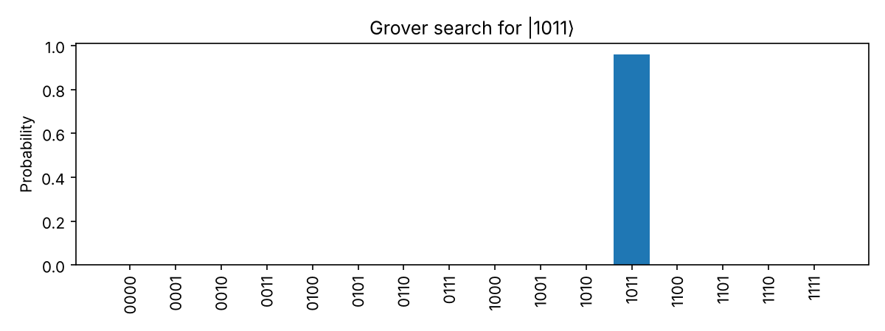

# qsim: a lightweight statevector quantum circuit simulator

A small quantum circuit simulator written from scratch in Python and NumPy. It supports single- and multi-qubit gates, measurement sampling and text circuit diagrams. Results are validated against [Qiskit](https://www.ibm.com/quantum/qiskit).

```python
from qsim import Circuit

bell = Circuit(2).h(0).cx(0, 1)
print(bell)
# q0: ─[H]───●───
# q1: ───────⊕───
print(bell.statevector())     # [0.707, 0, 0, 0.707]
print(bell.sample(1000))      # {'00': 473, '11': 527}
```

## How it works

- **State as a tensor.** *n* qubits are stored as a complex array of shape `(2,)*n` instead of a flat vector. Applying a *k*-qubit gate is one `np.tensordot` over the target axes followed by `np.moveaxis`, so the simulator never builds a full 2ⁿ × 2ⁿ matrix.
- **Gates.** H, X, Y, Z, S, T, RX/RY/RZ, CNOT, CZ, SWAP, a multi-controlled Z, and any custom unitary via `Circuit.apply(name, matrix, *wires)`.
- **Measurement.** `probabilities()` gives exact Born-rule probabilities. `sample(shots)` draws measurement outcomes.
- **Convention.** Qubit 0 is the leftmost (most significant) bit in labels like `|q0 q1 q2⟩`.

## Example algorithms (`qsim/algorithms.py`)

| Circuit | Check |
|---|---|
| Bell and GHZ states | Matches (|0…0⟩ + |1…1⟩)/√2 |
| Quantum teleportation | Qubit 2 ends in the sent state (fidelity 1.0) |
| Grover's search (3–4 qubits) | Marked state found with P ≈ 0.96 after 3 iterations |



## Validation against Qiskit

`tests/test_against_qiskit.py` rebuilds each circuit in Qiskit (mapping qsim's qubit order onto Qiskit's little-endian convention) and checks that the statevectors agree to 10⁻¹⁰. It covers Bell, GHZ, teleportation, Grover and a random 40-gate circuit.

```bash
pip install -r requirements.txt
pytest          # 10 passed
```

## Tutorial

[`tutorial.ipynb`](tutorial.ipynb) is a code-first walkthrough, from a single qubit in superposition to Grover's search.

## Ideas for later

- Noise channels with density matrices
- Parameter-shift gradients for variational circuits
- A matplotlib circuit drawer
